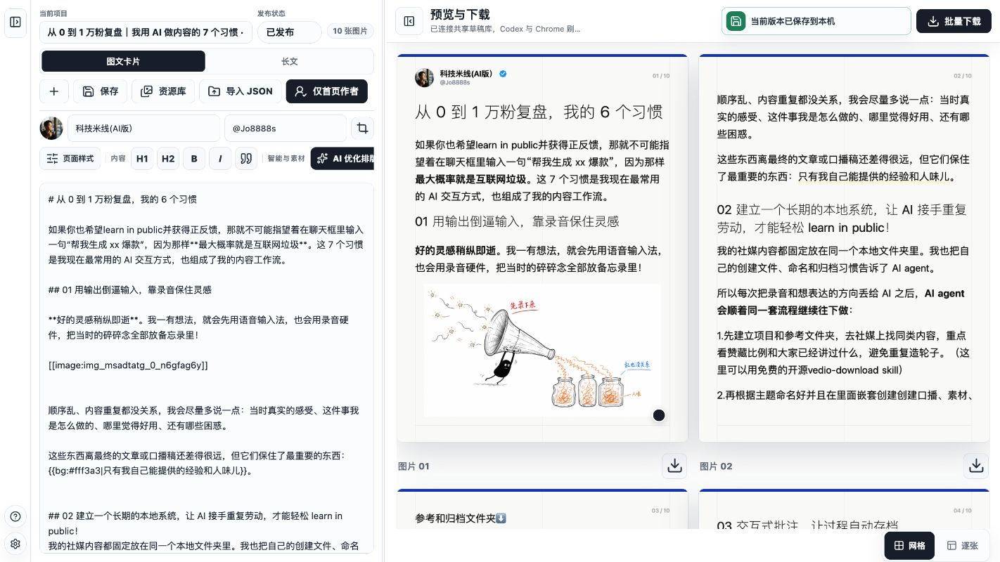
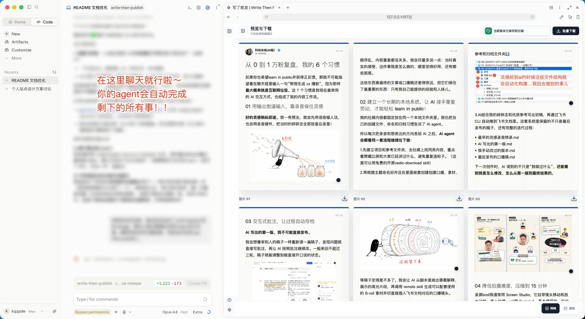
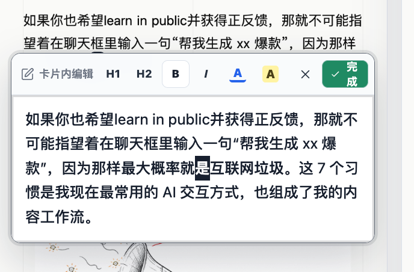
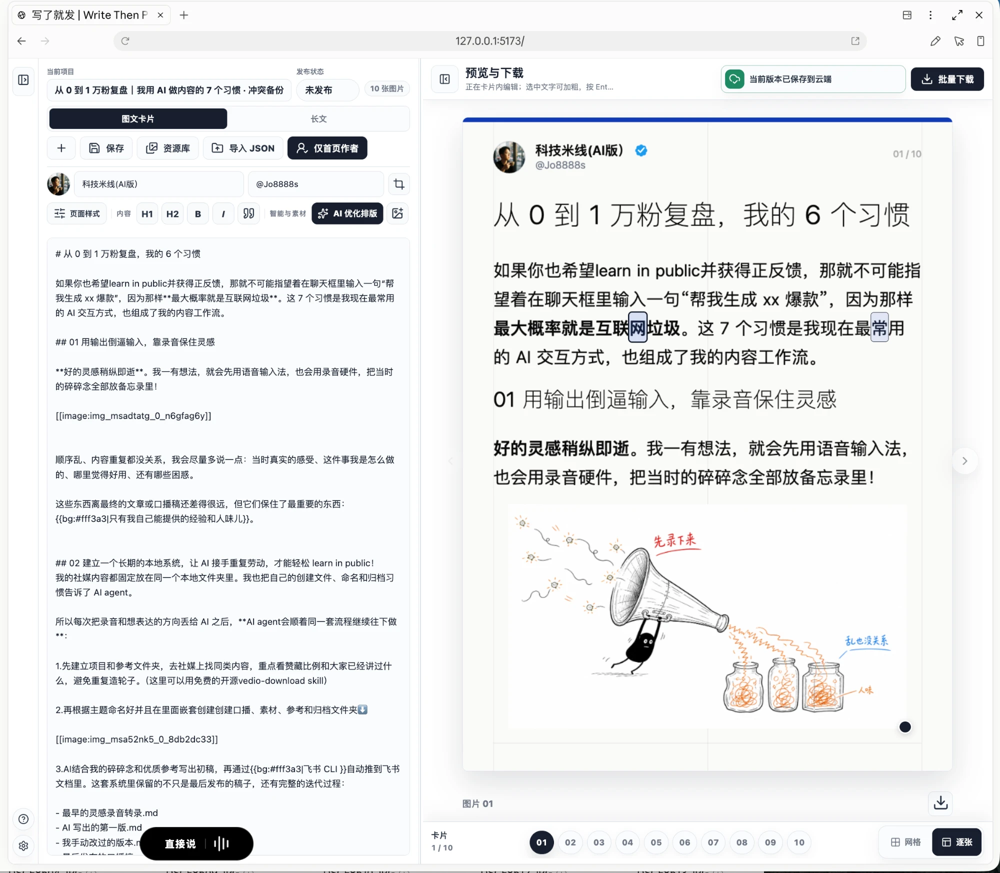
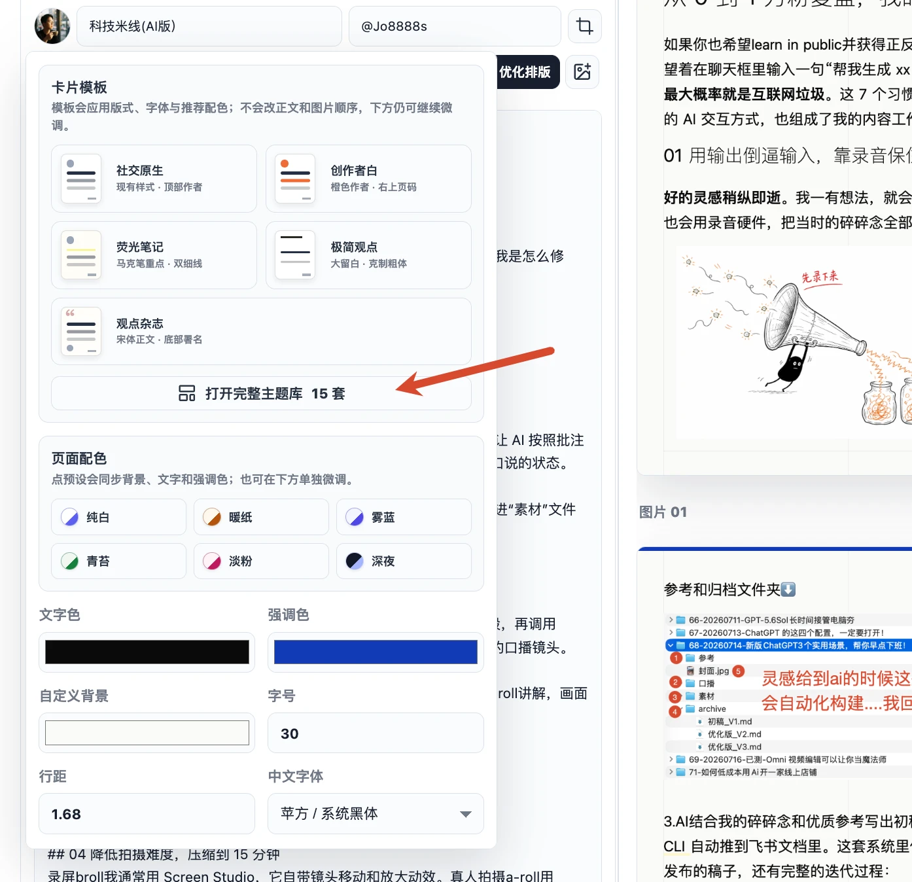
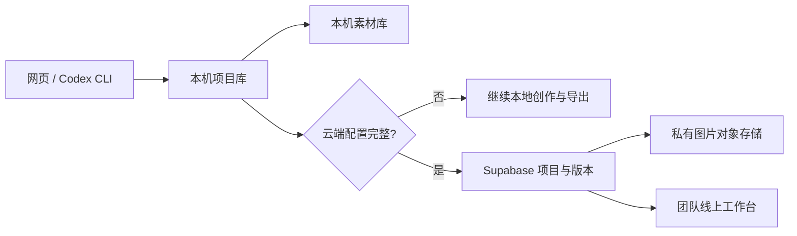

<div align="center">

# 说了就发 · Say Then Publish

### 在任意 Agent 里聊，聊完自动变成可以发布的图文卡片。

本地优先 · Agent 原生 · 图文卡片 / 长文 · Agent 直接排版 · 自动配图 · 可选团队协作

[](LICENSE)


</div>



> **你负责说，它负责发。** 在任意 Agent 窗口（Claude、Codex……）里聊你的想法、复盘、观点；触发这个技能，Agent 就把对话整理成结构化正文、自动排进右侧可以直接发布的图文卡片。你在卡片上直接改字、上色、换样式，满意了再让它自动配图——最后本地保存，或同步给线上团队。
>
> _前身是「写了就发 / Write Then Publish」——一个左边写 Markdown、右边实时出卡片的工作台。现在把入口前移到了「你在 Agent 里说」，写卡片只是其中一种方式。_

## 它现在就是一个可直接下载的 Skill

不需要先学项目结构，也不需要从 GitHub clone 代码。直接下载下面这个压缩包，放进 Codex、Claude Code 或其他兼容 Skill 的目录，然后对 Agent 说“初始化说了就发”：

### [下载 Say Then Publish Skill](release/say-then-publish-skill.zip?raw=1)

完整程序已经封装在 Skill 里面。第一次使用只会询问两件事：**你的小红书账号名称**，以及**平时存放社媒内容的文件夹**。没有配置 Supabase/TOS 时自动使用本地模式；配置后则继续支持线上团队协作。

## 从「说」到「发」，一条主线

1. **说** — 在任意 Agent 窗口里聊你的复盘、观点、碎碎念，怎么乱都行。
2. **成稿** — 触发这个技能，Agent 把对话整理成正文，自动分页排进图文卡片，右侧实时预览。
3. **审阅** — 直接在卡片上改字、上色 / 高亮、换主题样式——人和 Agent 同桌，成品始终可见可改。
4. **配图** — 满意后让 Agent 自动配图：先检查本机是否装了小黑生图技能，没装就给安装链接，装了就直接生图并插到对应小节。
5. **发** — 本地优先保存；配好云端服务后，同步给线上团队一起改。



### 为什么比「让 Agent 直接写」强：机器真的懂这套排版语言

以前 Agent 帮你做内容，**排版和强调这一步还是得人来**：手动加粗、挑高亮、上色、分页、对齐、选样式，繁琐又费时。

这个项目把「图文卡片」的排版语言（`**加粗**`、`{{color:…|…}}` 文字上色、`{{bg:…|…}}` 高亮、H1/H2、手动分页、15 套主题）做成了 Agent 能稳定读写的接口。于是机器不只是把字填进去，而是**真的理解哪里该加重、哪里该高亮、哪里分页、该套哪种社交 / 杂志 / 瑞士网格样式**——通过 CLI 一次成稿即成图，很多时候排得比手动还准，省掉了大量对齐和返工的时间。

> 人负责判断和表达，Agent 接手「理解 + 排版 + 配图」这类重复而讲究的活。

这份 README 分两块，按你的角色看其中一块就够了：

- **[给创作者 · For Human](#给创作者--for-human)**：它能帮你做什么，怎么用，长什么样。
- **[给 Agent · For Agent](#给-agent--for-agent)**：Agent 如何通过技能和稳定 CLI 把对话变成卡片、配图并校验版本。

---

## 给创作者 · For Human

### 一句话：你在 Agent 里说完，它直接排成能发的作品

你既可以**直接在 Agent 里聊**、让它成稿，也可以**自己在左栏写**。打开工作台就是左右两栏：

- **左栏是源文**——纯 Markdown，外加 `{{color:#5B5FEF|重点}}`、`{{bg:#fff3a3|高亮}}` 这类排版标记。
- **右栏是成品**——每敲一个字，右侧就实时重排成 `3:4` 竖版图文卡片，或保留结构的长文。

你不需要在“写文档”和“做图”之间来回切。想发小红书、X 长帖、知识卡片、公众号草稿，写完直接导出 `1× / 2× / 3×` 高清图。

**两种作品，一份源文：**

| 作品 | 适合 |
| --- | --- |
| **图文卡片** | 小红书、X 长帖截图、知识卡片、图文教程 |
| **长文** | 公众号草稿、博客、文章长图 |

### 直接点卡片改字，不用回源码里找

点右侧卡片上的任意文字，就地进入编辑；选中后可以继续设标题、加粗、斜体、**文字上色**和**高亮**，完成后安全写回正文——不必先在左侧一行行定位。



### 逐张放映：点两侧翻页，底部页码快速跳

切到「逐张」预览，卡片居中放大，像放映一样一张张看：

- **点卡片左半 / 右半**就翻到上一张 / 下一张，两侧有 `‹` `›` 提示；
- **底部一条页码条**（`01 02 03 …`）直接点数字跳到任意一页；
- 第一张 / 最后一张时对应方向的箭头会自动变灰。

比一张张点缩略图快，也更适合发布前逐页通读检查。



### Agent 直接完成排版

网页不再提供需要外接模型的“AI 优化排版”按钮。排版规则已经写进项目 Skill：Agent 直接读取最新版正文，判断主结论、数字、结果和转折，再用加粗、文字颜色、浅黄底色、标题和分页语法写回项目。

这样排版与普通修改使用同一条有版本保护的 CLI 链路，不需要把正文另发给一个外接排版服务，也不会出现网页建议版本和 Agent 修改互相覆盖的问题。

### 越用越懂你的个人创作记忆

公开 Skill 只保存通用能力，你的个人信息和偏好单独保存在本机：社媒名称、不同设备对应的公开账号、喜欢的标题语气、高亮密度、常用配色，以及你对成品说过的具体不满。

你可以直接告诉 Agent：“以后每张卡只高亮一个重点”“标题别太营销”“这台设备使用哪个公开账号”。Agent 会把它整理成一条可复用偏好；下一次排版前先读取，再逐渐贴近你的习惯。个人记忆不会写进 Skill、不会进入 GitHub，也不会混进分享压缩包；密码、验证码、Cookie、Token 和 API Key 会被拒绝保存。

### 15 套卡片主题，一键切换

点「页面样式」就能实时切换：15 套主题分「原生社交 / 纸墨杂志 / 瑞士网格」三个家族，还能单独微调配色、字体、字号。主题只改画布结构、字体和配色，**不动正文，也不打乱图片顺序**。



几套常用的：

| 样式 | 适合内容 | 主色 |
| --- | --- | --- |
| **社交原生** | 小红书、日常图文，作者信息置顶的熟悉社交结构 | `#2563eb` 经典蓝 |
| **创作者白** | 个人 IP、教程复盘；橙色作者名 + 右上页码 | `#EF6B35` 活力橙 |
| **观点杂志** | 长观点、评论、随笔；宋体正文 + 底部署名 | `#4F7D43` 墨绿 |
| **瑞士蓝** | AI、产品、工程、方法论；严格网格 + 高纯度蓝 | `#123BB6` 瑞士蓝 |
| **瑞士新绿** | 健康、生态、未来与新兴科技；现代荧光绿 | `#B9DB16` 荧光绿 |

> 另外还有荧光笔记、极简观点，以及纸墨经典、瓷蓝研究、森林手记、牛皮记忆、沙丘画廊、午夜鎏金、瑞士柠黄、瑞士安全橙等，覆盖商业评论、科技研究、自然生活到风险决策等题材。


### 支持团队协作（可选）

默认它是本地优先、一个人也能完整用的（见下方[本地模式](#不配置任何服务也能完整本地使用)）。但如果你希望**自己在本机写完，团队成员打开线上工作台就能接着改**，只要配好对应服务即可：

1. 用 Supabase 保存项目、版本基线和协作状态；
2. 用一个私有对象存储保存图片素材（当前实现支持火山引擎 TOS）；
3. 打开 `WRITE_THEN_PUBLISH_CLOUD_SYNC=1` 并重启。

配好之后，只要联网，你和线上伙伴看的就是同一套项目：**你在 Codex / 本机改的会同步上云，云端伙伴同时也能编辑。** 系统优先同步云端、同时保留本机副本；一旦云端不可用会自动降级到本地，不会挡住你继续写和导出。两人从同一版本各自修改时，系统不会用最后一次保存静默覆盖，而是保留冲突副本，等你确认后再合并。

---

## 给 Agent · For Agent

「说了就发」的核心，就是这一层：Agent 通过一套稳定 CLI（`scripts/wtp.py`）和项目技能，把对话变成排好版的图文卡片，再配图、校验版本——**这套排版语言（加粗 / 上色 / 高亮 / 标题 / 分页 / 主题）机器都能读懂并稳定写出**，所以成稿即成图。

同一份本机项目库，网页和 Agent 读写的是同一份数据。约定很克制：Agent 先读最新版本，再做有条件的更新；插图必须锚定正文里唯一的标题行，找不到或重复时会停下，而不是猜位置。

配图前，技能会先检查本机是否装了**小黑生图技能**：没装就给出安装链接让你一键配置（不内置、不代装），装了就直接生图并插到对应小节。

**把技能装进任意 Agent。** 技能就放在仓库的 `.agents/skills/write-then-publish/`；软链到对应 Agent 的技能目录即可被读取：

```bash
ln -s "$(pwd)/.agents/skills/write-then-publish" ~/.claude/skills/write-then-publish   # Claude Code
ln -s "$(pwd)/.agents/skills/write-then-publish" ~/.codex/skills/write-then-publish     # Codex
```

之后在任意 Agent 窗口里聊完，说一句「把这段整理成图文卡片」或「帮我配图」，它就会走上面这套 CLI 流程。

```bash
# 查看服务与云端状态
.venv/bin/python scripts/wtp.py status

# 列出、读取项目
.venv/bin/python scripts/wtp.py list
.venv/bin/python scripts/wtp.py get PROJECT_ID

# 把聊出来的内容排进图文卡片（正文用上排版语言）
.venv/bin/python scripts/wtp.py create \
  --title "从 0 到 1 万粉复盘｜我用 AI 做内容的 7 个习惯" \
  --from-file "/absolute/path/万粉复盘.md"

# 把 Agent 生成的配图插入到某个唯一标题之后
.venv/bin/python scripts/wtp.py add-image PROJECT_ID \
  --file "/absolute/path/illustration.png" \
  --after-line "## 01 用输出倒逼输入，靠录音保住灵感" \
  --name "01-配图.png"
```

装了小黑生图技能后，可以直接下指令，让它生图 + 判断插入位置 + 确认保存：

> 给「万粉复盘」项目的第 01、03 节按“小黑 style”各生成一张配图，插在对应标题后，不改正文，并确认保存状态。

生图、判断插入位置和版本确认都由 Agent 完成；网页端不再替 Agent 去公共图库盲搜。CLI 默认省略内嵌图片的 Base64 数据，避免终端日志泄露大体积内容。

---

## 30 秒开始使用

需要 macOS / Linux、Python 3 和一个现代浏览器。首次启动会在项目内自动创建 Python 虚拟环境。

```bash
git clone https://github.com/Jo6666887/say-then-publish.git
cd say-then-publish
npm start
```

然后打开：

```text
http://127.0.0.1:5173/
```

也可以在 macOS Finder 中双击 `启动说了就发.command`。

> 建议始终使用 `127.0.0.1:5173`，不要在 `localhost` 和 `127.0.0.1` 之间切换；浏览器会把它们视为两个不同站点。

## 不配置任何服务，也能完整本地使用

这是开源版的默认状态，不需要 Supabase、对象存储或任何外接排版服务。

| 能力 | 零配置本地模式 |
| --- | --- |
| 正文与项目历史 | 自动保存到 `runtime-data/project-store.json` |
| 图片素材 | 自动写入 `runtime-data/assets/`，按内容去重 |
| 浏览器离线副本 | LocalStorage + IndexedDB |
| Agent 操作 | 使用同一套本地 CLI |
| 备份迁移 | 导入 / 导出 JSON |
| 卡片与长图导出 | 完全本地完成 |

`runtime-data/`、`.env`、`backups/` 和本机素材都已加入 Git 忽略列表，也不会通过本地网页静态服务暴露。

## 需要团队协作时，再打开云端模式

```bash
cp .env.example .env
chmod 600 .env
npm start
```

所有凭据只放在被 Git 忽略的本机 `.env`，由 Python 服务读取。浏览器代码、项目 JSON、截图和 CLI 输出都不应出现真实密钥。协作细节见上方[支持团队协作](#支持团队协作可选)。

## 保存模型



本地保存、云端同步、图片导出和真正发布是四个独立状态。界面会区分它们，不会把“已经预览”误报成“已经发布”。

## 隐私与安全

- 不提交 `.env`、本机草稿、素材库、备份或访问凭据。
- Supabase Secret、对象存储 AK/SK 只在服务端读取。
- 静态文件采用白名单；`.env`、`.git`、Python 源码、SQL、测试和运行数据不会被本地 HTTP 服务返回。
- CLI 默认省略内嵌图片的 Base64 数据，避免终端日志泄露大体积内容。
- 对外部署必须增加身份认证和 TLS；不要把无登录的本地服务直接暴露到公网。

公开仓库前建议运行：

```bash
git diff --check
.venv/bin/python -m unittest discover -s tests -p 'test_*.py'
```

更完整的安全说明见 [SECURITY.md](SECURITY.md)。

## 项目结构

```text
.
├── index.html                     # 工作台结构
├── src/                           # 前端交互与样式
├── server.py                      # 本地项目 / 资源 / 云同步服务
├── scripts/wtp.py                 # Agent 稳定 CLI
├── .agents/skills/                # Codex 项目 Skill
├── local_asset_store.py           # 零配置本机素材库
├── cloud_store.py                 # 可选云端协作
├── runtime-data/                  # 本机数据，Git 忽略
└── tests/                         # 单元、契约与端到端测试
```

## 上游致谢

本项目基于 [fxyadela/write-then-publish](https://github.com/fxyadela/write-then-publish) 的 MIT 许可代码继续开发。感谢原作者“捏捏番茄”提供最初的产品方向和开源实现。

这个仓库不是要抹去原作，而是记录一个创作者如何把它继续改造成自己的本地优先、Agent 友好和团队协作工作流。详细归属见 [NOTICE.md](NOTICE.md)，许可证见 [LICENSE](LICENSE)。

## 参与贡献

欢迎提交 Issue 或 Pull Request，尤其是：

- 新的图文主题与中文排版细节。
- 更通用的对象存储适配器。
- Agent / Skill 创作工作流。
- 本地数据可靠性、冲突恢复与跨平台支持。

如果这个项目帮你少做了一点重复劳动，也欢迎告诉我你用它完成了什么作品。
