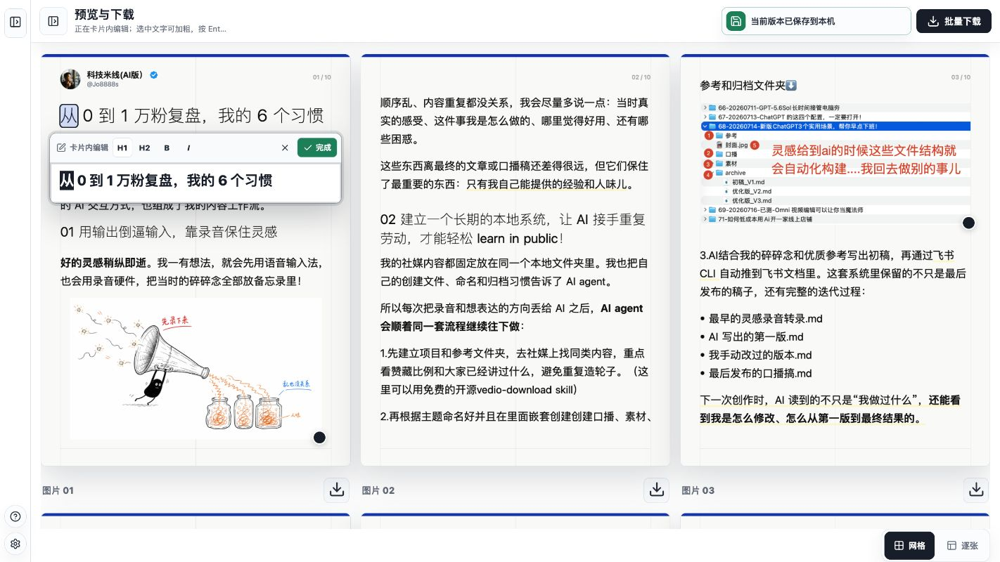
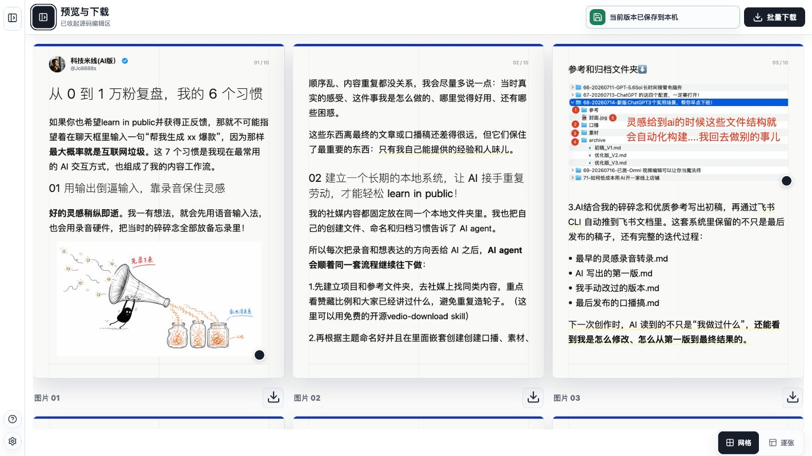
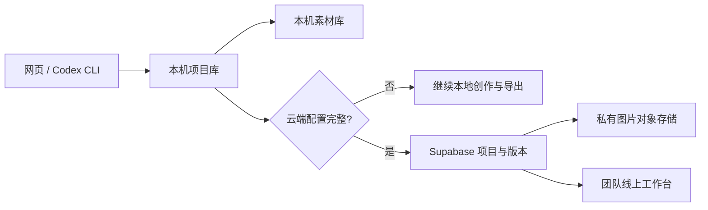

<div align="center">

# 写了就发 · Write Then Publish

### 让 Agent 不只帮你写稿，而是直接把内容变成可以发布的作品。

本地优先 · Codex 原生工作流 · 图文卡片 / 长文 · 可选云端协作

[](LICENSE)


</div>


> 粘贴一篇文章，右侧实时生成可发布的图文卡片；也可以直接让 Codex 通过 CLI 创建项目、插入配图、调整内容，并把结果安全保存到本机或同步给线上伙伴。

## 为什么做这个项目

内容创作者真正耗时间的，往往不是“写出第一版”，而是后面的工作：拆卡、排版、插图、反复修改、导出，以及把同一个项目交给团队继续编辑。

我最初从 [fxyadela/write-then-publish](https://github.com/fxyadela/write-then-publish) 获得灵感并基于其代码继续开发。这个版本保留了原项目“写完就能发”的核心方向，同时围绕我自己的真实创作流程做了大量改造：

- 从单纯的网页排版工具，升级为 Agent 可以稳定调用的创作工作台。
- 增加本地 CLI 和项目 Skill，让 Codex 能读、写、插图、保存与检查版本。
- 支持在右侧卡片中直接修改文字，减少源码与成品之间的来回切换。
- 针对 Codex 右侧窄窗口重做布局、缩放、拖动分栏与多列预览。
- 建立本地优先、云端可选的保存模型；没有任何云服务也能完整使用。
- 云端协作时保留版本基线，双方同时编辑不会静默覆盖，而是保留冲突副本。

这不是一个“帮你生成爆款”的按钮。它更像一张创作桌：人负责判断和表达，Agent 接手重复劳动，最终成品始终可见、可改、可验证。

## 现在可以做什么

### 1. 一篇内容，生成两种作品

- **图文卡片**：自动分页为 `3:4` 竖版卡片，适合小红书、X 长帖截图、知识卡片和图文教程。
- **长文**：保留 Markdown 结构、图片与行内样式，适合公众号草稿、博客和文章长图。

支持标题、加粗、斜体、引用、文字颜色、背景高亮、图片、手动分页，以及 `1× / 2× / 3×` 高清导出。

### 2. 直接在成品上修改

双击右侧卡片文字即可进入实时编辑，不必先定位左侧源码。选中文字后可以继续设置标题、加粗和斜体，完成后再安全写回正文。



### 3. 为 Codex 窄窗口设计的工作台

中间分隔条可拖动，源码区可一键收起。右侧根据真实可用宽度自动显示一、二或三列，一行最多三张卡片。



### 4. Agent 原生，而不是网页里再放一个伪 AI 按钮

仓库内置稳定 CLI 和项目 Skill。Agent 可以先读取最新版本，再执行有条件的更新；插图必须锚定正文中的唯一标题行，找不到或出现重复时会停止，而不是猜位置。

```bash
# 查看服务与云端状态
.venv/bin/python scripts/wtp.py status

# 列出、读取项目
.venv/bin/python scripts/wtp.py list
.venv/bin/python scripts/wtp.py get PROJECT_ID

# 从 Markdown 创建项目
.venv/bin/python scripts/wtp.py create \
  --title "我的新文章" \
  --from-file "/absolute/path/article.md"

# 把 Agent 生成的图片插入唯一标题后
.venv/bin/python scripts/wtp.py add-image PROJECT_ID \
  --file "/absolute/path/illustration.png" \
  --after-line "## 01 这一节的完整标题" \
  --name "01-配图.png"
```

如果 Codex 支持原生生图，可以直接告诉它：

> 给当前项目的第 01、03 节按“小黑 style”各生成一张配图，插在对应标题后，不改正文，并确认保存状态。

网页不再替 Agent 去公共图库里盲目搜图；生图、判断插入位置和版本确认都由 Agent 完成。

## 30 秒开始使用

需要 macOS / Linux、Python 3 和一个现代浏览器。首次启动会在项目内自动创建 Python 虚拟环境。

```bash
git clone https://github.com/Jo6666887/write-then-publish.git
cd write-then-publish
npm start
```

然后打开：

```text
http://127.0.0.1:5173/
```

也可以在 macOS Finder 中双击：

```text
启动写了就发.command
```

> 建议始终使用 `127.0.0.1:5173`，不要在 `localhost` 和 `127.0.0.1` 之间切换；浏览器会把它们视为两个不同站点。

## 不配置任何服务，也能完整本地使用

这是开源版的默认状态，不需要 Supabase、对象存储或 AI Key。

| 能力 | 零配置本地模式 |
| --- | --- |
| 正文与项目历史 | 自动保存到 `runtime-data/project-store.json` |
| 图片素材 | 自动写入 `runtime-data/assets/`，按内容去重 |
| 浏览器离线副本 | LocalStorage + IndexedDB |
| Agent 操作 | 使用同一套本地 CLI |
| 备份迁移 | 导入 / 导出 JSON |
| 卡片与长图导出 | 完全本地完成 |

`runtime-data/`、`.env`、`backups/` 和本机素材都已加入 Git 忽略列表，也不会通过本地网页静态服务暴露。

## 需要团队协作时，再打开云端模式

如果你希望自己在 Codex / 本机改完，团队成员打开线上工作台就能继续编辑，可以配置服务器端 `.env`：

1. Supabase 保存项目、版本基线和协作状态。
2. 私有对象存储保存图片素材；当前实现支持火山引擎 TOS。
3. 设置 `WRITE_THEN_PUBLISH_CLOUD_SYNC=1` 后重启服务。

```bash
cp .env.example .env
chmod 600 .env
npm start
```

所有凭据只放在被 Git 忽略的本机 `.env`，由 Python 服务读取。浏览器代码、项目 JSON、截图和 CLI 输出都不应出现真实密钥。

配置完整时，系统优先同步云端，同时保留本机副本；没有配置、配置不完整或云端暂时不可用时，自动降级到本地保存，不会阻止继续写作和导出。

### 同时编辑如何处理

本地与云端都记录共同版本基线。如果你和团队伙伴从同一版本开始各自修改：

- 云端伙伴的版本保留在原项目 ID 下。
- 你的本机修改保存为单独的“冲突副本”。
- 系统不会自动拼接文案，也不会用最后一次保存静默覆盖另一方。
- Agent 可以读取两个版本，在你确认后再执行合并。

## 保存模型



本地保存、云端同步、图片导出和真正发布是四个独立状态。界面会区分它们，不会把“已经预览”误报成“已经发布”。

## 更多创作能力

- 多项目历史、发布 / 未发布状态与安全复制项目。
- 15 套图文主题、独立中英文字体、配色和页面细调。
- Obsidian Markdown 与本机附件识别。
- 图片粘贴、拖入、裁剪、大小调整、排序和素材复用。
- AI 排版建议先预览差异，再由用户确认应用，并可撤回。
- 输入优先的增量渲染、图片缓存和多卡片复用，长稿编辑更流畅。
- Codex / Chrome 读取同一份本机项目库。
- `Command + Z` / `Command + Shift + Z` 撤销与重做。

## 隐私与安全

- 不提交 `.env`、本机草稿、素材库、备份或访问凭据。
- Supabase Secret、对象存储 AK/SK、AI Key 只在服务端读取。
- 静态文件采用白名单；`.env`、`.git`、Python 源码、SQL、测试和运行数据不会被本地 HTTP 服务返回。
- CLI 默认省略内嵌图片的 Base64 数据，避免终端日志泄露大体积内容。
- 对外部署必须增加身份认证和 TLS；不要把无登录的本地服务直接暴露到公网。

公开仓库前建议运行：

```bash
git diff --check
.venv/bin/python -m unittest discover -s tests -p 'test_*.py'
```

更完整的安全说明见 [SECURITY.md](SECURITY.md)。

## 项目结构

```text
.
├── index.html                     # 工作台结构
├── src/                           # 前端交互与样式
├── server.py                      # 本地项目 / 资源 / 云同步服务
├── scripts/wtp.py                 # Agent 稳定 CLI
├── .agents/skills/                # Codex 项目 Skill
├── local_asset_store.py           # 零配置本机素材库
├── cloud_store.py                 # 可选云端协作
├── runtime-data/                  # 本机数据，Git 忽略
└── tests/                         # 单元、契约与端到端测试
```

## 上游致谢

本项目基于 [fxyadela/write-then-publish](https://github.com/fxyadela/write-then-publish) 的 MIT 许可代码继续开发。感谢原作者“捏捏番茄”提供最初的产品方向和开源实现。

这个仓库不是要抹去原作，而是记录一个创作者如何把它继续改造成自己的本地优先、Agent 友好和团队协作工作流。详细归属见 [NOTICE.md](NOTICE.md)，许可证见 [LICENSE](LICENSE)。

## 参与贡献

欢迎提交 Issue 或 Pull Request，尤其是：

- 新的图文主题与中文排版细节。
- 更通用的对象存储适配器。
- Agent / Skill 创作工作流。
- 本地数据可靠性、冲突恢复与跨平台支持。

如果这个项目帮你少做了一点重复劳动，也欢迎告诉我你用它完成了什么作品。
